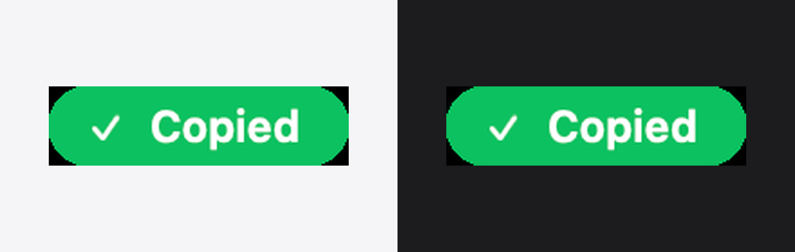

# RogerThat

<sub>English · [简体中文](README.zh-CN.md)</sub>

A 22-point-tall green pill that shows up the instant your clipboard actually changes — so you can stop pressing ⌘C twice out of doubt.



macOS 13+. Menu bar app, ~250 lines of Swift, no dependencies, no permissions.

## Why

⌘C is silent. If an app swallows the keystroke, or you copied the wrong selection, you only find out one paste later. RogerThat watches the pasteboard itself and gives you a quiet "Copied" only when something really landed.

## Install

1. Download `RogerThat-1.0.0.zip` from [Releases](../../releases) and unzip it.
2. Drag `RogerThat.app` into `/Applications`.
3. First launch — the build is ad-hoc signed, not notarized, so macOS will complain: right-click the app → **Open**, or run

   ```sh
   xattr -dr com.apple.quarantine /Applications/RogerThat.app
   ```

## Usage

The settings window opens on every launch, so you always know it is running — even with the menu bar icon hidden.

| Switch | What it does |
| --- | --- |
| Show notification | Master switch for the pill |
| Show copied text | Adds the first 40 characters of the copied text (off by default; see privacy below) |
| Show menu bar icon | Adds or removes the menu bar item; reopen Settings from that menu |
| Launch at login | Registers RogerThat as a login item (macOS's own Login Items, no helper script) |

## How it works

RogerThat polls `NSPasteboard.general.changeCount` every 0.15s. When the counter moves, the pasteboard top really changed, so the pill appears next to the cursor and fades out after 1.1s. No keyboard monitoring, no Accessibility permission, no Input Monitoring permission.

Two consequences worth knowing:

- It reacts to **any** pasteboard write, not only ⌘C: a screenshot to the clipboard, a copy in another app, a menu-bar Edit → Copy all trigger it. That is the honest definition of "did my copy land", but it is not a "you pressed ⌘C" detector (that needs Input Monitoring for a strictly worse answer).
- With **Show copied text** on, RogerThat reads the pasteboard contents. Apple has announced a system alert for apps that programmatically read the general pasteboard (previewed in macOS 15.4 behind a developer flag). Reading the counter alone avoids that permanently, which is why content preview is opt-in.

## Build from source

Only the Command Line Tools are needed — no Xcode project.

```sh
./build.sh
open dist/RogerThat.app
```

`--selftest` checks the change-detection logic against a private pasteboard (it never touches your clipboard).

## License

MIT